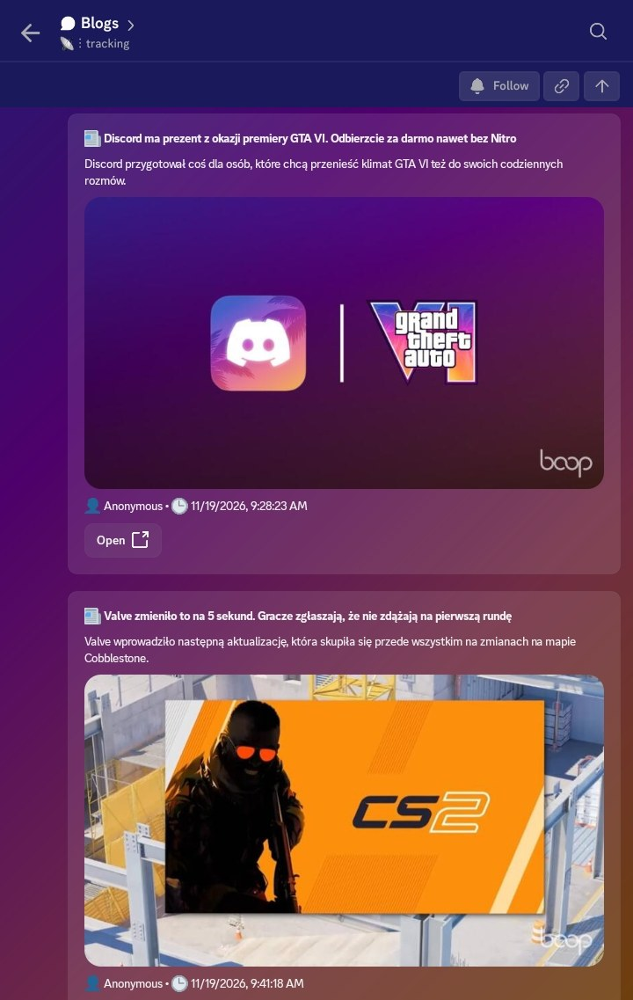
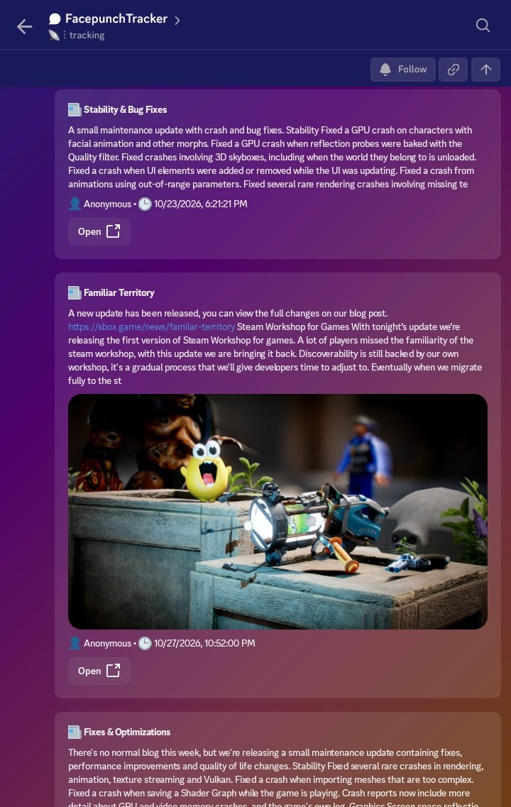
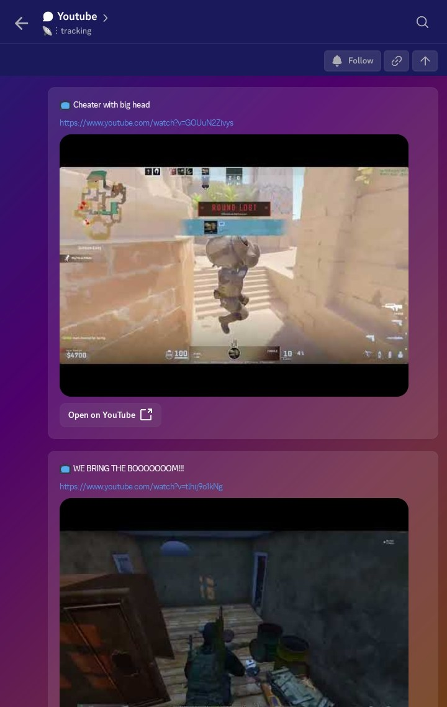

<div align="center">

# XFeeder

**News, game updates, commits and videos delivered to Discord and Telegram the moment they are found.**


</div>

<table>
  <tr>
    <td align="center"><br><sub>Blogs</sub></td>
    <td align="center"><br><sub>GitHub commits</sub></td>
    <td align="center"><br><sub>Valve tracker</sub></td>
  </tr>
  <tr>
    <td align="center"><br><sub>Facepunch tracker</sub></td>
    <td align="center"><br><sub>Steam news</sub></td>
    <td align="center"><br><sub>YouTube</sub></td>
  </tr>
</table>

## Why XFeeder

- **One small binary.** Written in Rust: no Node.js, no Docker, nothing to install next to it.
- **Light.** About 35 MB of memory and 1.5 % CPU with 10 channels and 32 feeds.
- **Never posts twice.** Delivery history is kept per destination and survives crashes and
  restarts; a new feed does not flood the channel with old entries.
- **Gets through Cloudflare.** Sites that block bots are fetched with a real browser
  (Scrapling) or FlareSolverr, and only when they actually block.
- **Looks good in Discord.** Cards with image, author and date (Components V2), posts into
  forum threads; Telegram with photos as well.
- **You decide what is posted.** Per-channel filters (words or regex, maximum age) and
  check intervals.
- **No restarts.** Changes to `config.json` and `.env` apply on their own.
- **Shows what is slow.** 24/7 diagnostics measure the delay from publication to Discord and
  suggest what to change.
- **Web dashboard** to edit channels and settings, with no JavaScript.

**Sources:** RSS, Atom, JSON Feed, YouTube channels, GitHub commits, Steam and SteamDB news,
any page that links its feed, Discord channels.
**Destinations:** Discord webhooks (channels and forum threads), Telegram (chats, channels,
topics).

## Quick start

```sh
cargo build --release                 # binary: target/release/xfeeder
cp config.json.example config.json
cp .env.example .env                  # webhook URLs and tokens go here
./xfeeder --check-config              # validate
./xfeeder --dry-run --once            # test run: fetch everything, post nothing
./xfeeder                             # run
```

The smallest working `config.json`:

```json
{
  "channels": {
    "news": {
      "Webhook": "${DISCORD_WEBHOOK}",
      "RSS": ["https://example.com/feed.xml"]
    }
  }
}
```

## Documentation

| | |
|---|---|
| [Configuration guide](docs/configuration.md) | Easy → medium → hard (Cloudflare) setup, and every setting explained (Polish) |
| [Deployment](docs/deployment.md) | Building on a server and running under systemd ([unit files](deploy/systemd)) |
| [Scrapling](scrapling/README.md) | Installing the browser for sites that block bots |
| [Architecture](docs/architecture.md) | How the code is organised |
| [Changelog](CHANGELOG.md) | What changed, with measurements |

Upgrading from 2.x: keep `config.json`, `.env` and `cache.json` and start `xfeeder` in the
same folder; nothing is posted again.

## License

[MIT](LICENSE)
