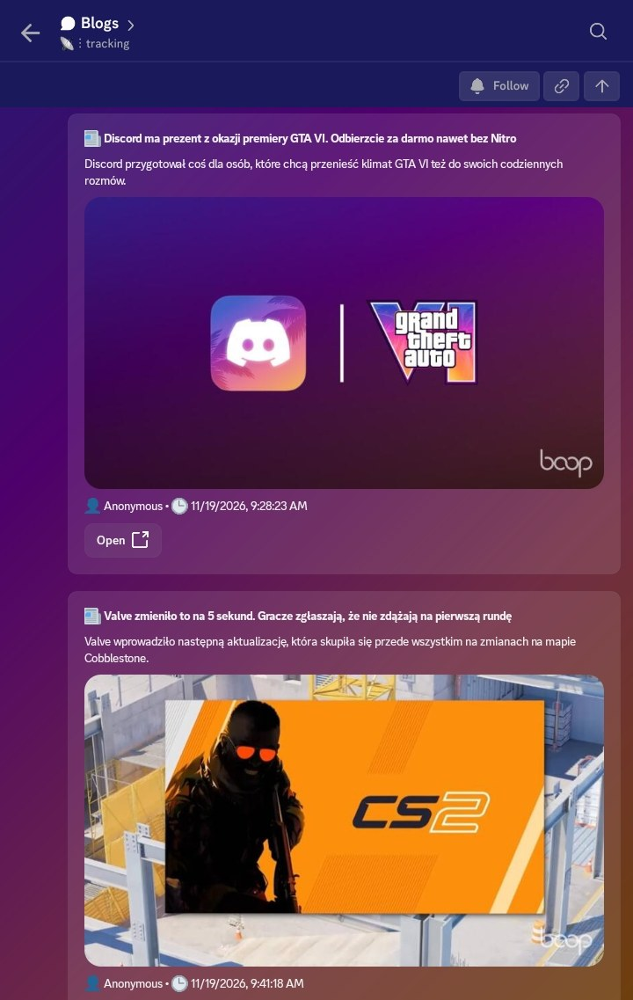
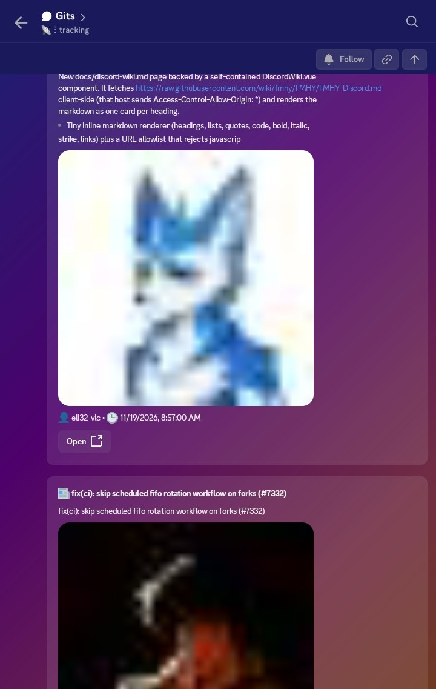
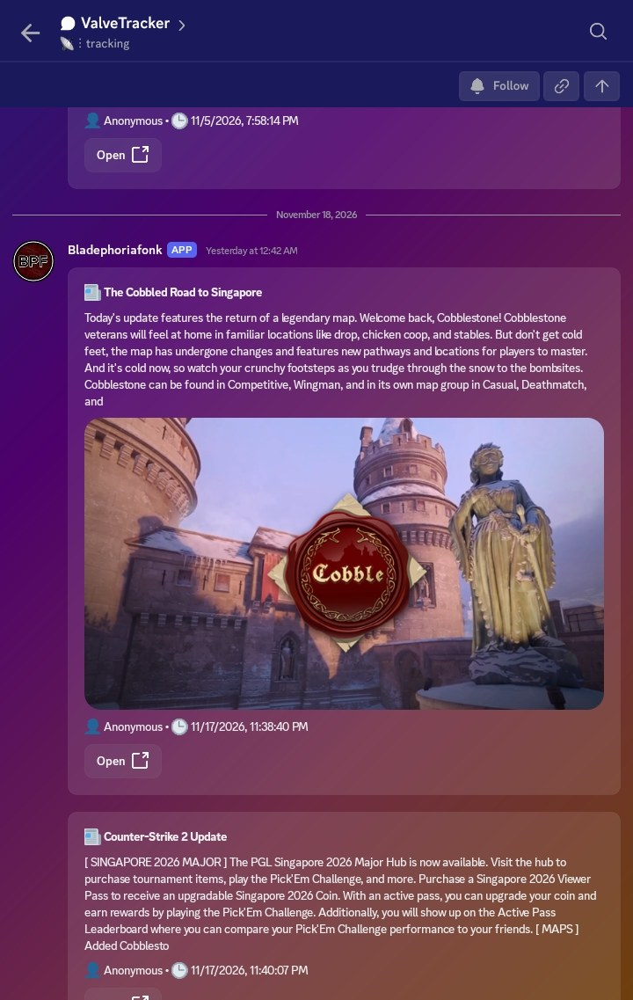
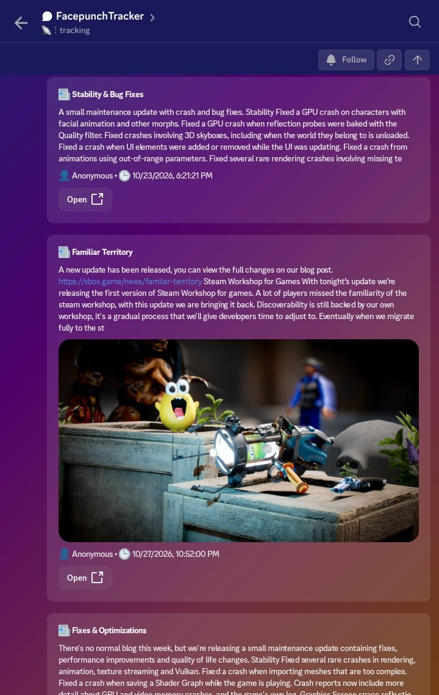
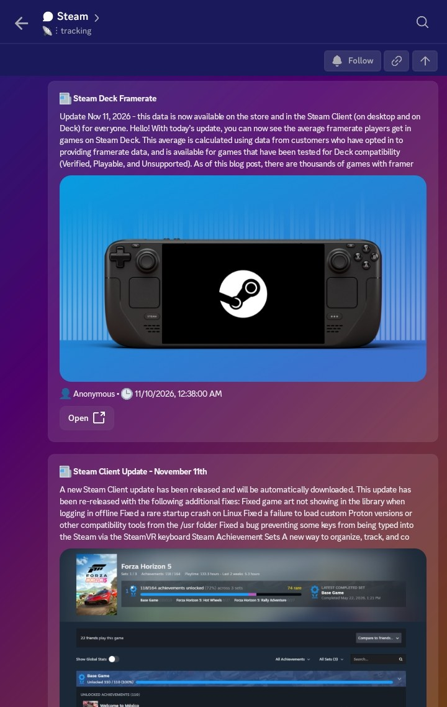
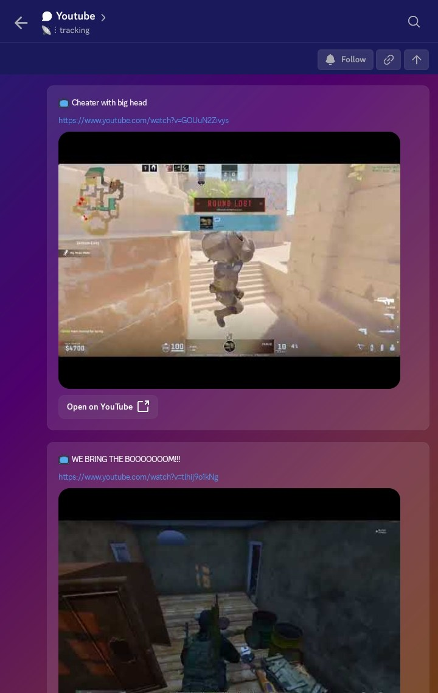

<div align="center">

# XFeeder

[English](README.md) · **Polski**

**Newsy, aktualizacje gier, commity i filmy na Discordzie i Telegramie w chwili, gdy się pojawią.**


</div>

<table>
  <tr>
    <td align="center"><br><sub>Blogi</sub></td>
    <td align="center"><br><sub>Commity z GitHuba</sub></td>
    <td align="center"><br><sub>Valve tracker</sub></td>
  </tr>
  <tr>
    <td align="center"><br><sub>Facepunch tracker</sub></td>
    <td align="center"><br><sub>Newsy ze Steama</sub></td>
    <td align="center"><br><sub>YouTube</sub></td>
  </tr>
</table>

## Dlaczego XFeeder

- **Jeden mały plik.** Napisany w Rust: bez Node.js, nic nie trzeba instalować obok. Obrazy Dockera są opcjonalne ([docs/docker.pl.md](docs/docker.pl.md)).
- **Lekki.** Około 35 MB pamięci i 1,5 % CPU przy 10 kanałach i 32 feedach.
- **Nigdy nie wysyła dwa razy.** Historia wysyłek jest zapisywana osobno dla każdego celu
  i przetrwa awarie oraz restarty; nowy feed nie zasypuje kanału starymi wpisami.
- **Przechodzi przez Cloudflare.** Strony blokujące boty są pobierane prawdziwą przeglądarką
  (Scrapling) albo przez FlareSolverr, i tylko wtedy, gdy faktycznie blokują.
- **Dobrze wygląda na Discordzie.** Karty z obrazkiem, autorem i datą (Components V2), posty
  w wątkach forum; na Telegramie też ze zdjęciami.
- **Ty decydujesz, co idzie.** Filtry na kanał (słowa albo regex, maksymalny wiek wpisu)
  i interwały sprawdzania.
- **Bez restartów.** Zmiany w `config.json` i `.env` działają same.
- **Pokazuje, co jest wolne.** Diagnostyka 24/7 mierzy czas od publikacji do Discorda
  i podpowiada, co zmienić.
- **Panel WWW** bez JavaScriptu: kanały, posty, logi, wykresy i diagnostyka; edycja
  ustawień, sprawdzenie kanału od razu albo ponowne wysłanie wpisu.

**Źródła:** RSS, Atom, JSON Feed, kanały YouTube, GitHub (commity, issue, pull requesty,
wydania, gałęzie), newsy ze Steama i SteamDB, każda strona, która linkuje swój feed, kanały Discorda.
**Cele:** webhooki Discorda (kanały i wątki forum), Telegram (czaty, kanały, tematy).

### Jak działa „nigdy nie wysyła dwa razy”

Każdy wpis dostaje identyfikator, pierwszy z tych, który istnieje:

1. klucz nadany przez źródło (buildy Steama, notatki Minecrafta);
2. jego link, oczyszczony z `utm_*` i innych parametrów śledzących oraz z `#…`, więc
   `https://strona.pl/post?utm_source=rss` i `https://strona.pl/post` to ten sam wpis;
3. jego guid;
4. skrót z tytułu, daty, autora i tekstu, dla wpisów bez linku i guida.

Wysłane identyfikatory są trzymane osobno dla każdego kanału i celu (Discord, Telegram) w
`cache.json`, do 2000 na feed, a plik jest zapisywany od razu po każdej udanej wysyłce
(przez plik tymczasowy i zmianę nazwy, więc awaria nie zostawi go w połowie zapisanego).
Z jednego `cache.json` może korzystać tylko jeden worker.

Przykłady:

- **Nowy feed** z 50 starymi wpisami: pierwsze sprawdzenie oznacza je jako widziane i nic
  nie wysyła albo tylko `FirstRunSend` najnowszych. Kanał nie zostaje zasypany.
- **Poprawiony wpis** (nowy tytuł lub tekst, ten sam link): nie idzie drugi raz.
- **Feed z dwoma wpisami pod jednym linkiem** (kernel.org, strony z notatkami wydań): każdy
  ma od tej pory własny identyfikator (`link#guid`), więc żaden nie wraca, gdy drugi zniknie.
- **Restart albo awaria**: historia jest na dysku, więc po restarcie idą tylko naprawdę nowe
  wpisy.

Ograniczenia:

- Strona, która zmieni linki starych wpisów (nowy schemat adresów, nowa domena), zrobi z
  nich nowe wpisy.
- Historia należy do adresu feedu: zmiana adresu zaczyna nową historię i stare wpisy
  powstrzymuje tylko zasada pierwszego sprawdzenia (`FirstRunSend`).
- Feed, który pokazuje naraz więcej niż 2000 wpisów, może ponowić wpisy, które wypadły z
  historii.
- Jeśli worker zostanie zabity dokładnie między przyjęciem posta przez Discorda a zapisem
  historii, ten jeden post może przyjść ponownie.

### Jak pobierane są strony za Cloudflare

1. Każdy feed najpierw jest pobierany zwykłym zapytaniem (ułamek sekundy).
2. Dopiero gdy strona odpowie 403/429/503 albo stroną sprawdzania („Just a moment…”),
   XFeeder otwiera prawdziwą przeglądarkę przez [Scrapling](scrapling/README.md) (Chromium
   z Patchright), która przechodzi sprawdzenie Cloudflare jak odwiedzający, albo pyta
   FlareSolverr. Feedy, które nie blokują, nigdy nie uruchamiają przeglądarki.
3. Z `Scrapling.ReuseClearance` ciasteczko zdobyte przez przeglądarkę służy zwykłym
   zapytaniom, dopóki nie wygaśnie.

Przykład z produkcji: boop.pl przez przeglądarkę to około 26 s na sprawdzenie, a z
ponownie użytym ciasteczkiem 8–11 ms; gry-wideo.pl przestał blokować i z `"fallback": true`
sam wrócił z 10,5 s do 0,3 s.

Ograniczenia:

- Scrapling musi być zainstalowany obok XFeedera (albo użyty obraz Dockera `scrapling`):
  około 1,6 GB z Chromium i kilkaset MB pamięci, gdy przeglądarka działa.
- Przechodzi automatyczne sprawdzenie Cloudflare. Strona, która każe człowiekowi rozwiązać
  CAPTCHA, reguła zapory przeciw IP serwera (403 bez `cf-mitigated`) albo inne usługi
  (DataDome, Akamai) mogą dalej blokować.
- Służy do publicznych feedów, które otwiera przeglądarka; nie loguje się i nie omija
  paywalli. Pamiętaj o regulaminie strony.

Krok po kroku: [przewodnik konfiguracji, poziom 3](docs/configuration.pl.md#poziom-3-trudny-strony-które-blokują-boty-cloudflare).

## Szybki start

Najprościej: pobierz `XFeeder.zip` z [Releases](https://github.com/yhymid/XFeeder/releases/latest),
rozpakuj i postępuj według `Instruction.pl.md` w środku (gotowy plik dla Linuksa x86_64). Ze źródeł:

```sh
cargo build --release
cp target/release/xfeeder .
cp config.json.example config.json
cp .env.example .env                  # tu wpisujesz adresy webhooków i tokeny
./xfeeder --check-config              # sprawdzenie configu
./xfeeder --dry-run --once            # próba: pobiera wszystko, nic nie wysyła
./xfeeder                             # uruchomienie
```

Najmniejszy działający `config.json`:

```json
{
  "channels": {
    "news": {
      "Webhook": "${DISCORD_WEBHOOK}",
      "RSS": ["https://example.com/feed.xml"]
    }
  }
}
```

## Dokumentacja

| | |
|---|---|
| [Konfiguracja](docs/configuration.pl.md) | Ustawienie łatwe → średnie → trudne (Cloudflare) i opis każdej opcji |
| [Dashboard](docs/dashboard.pl.md) | Każda strona panelu WWW, dostęp przez SSH, bezpieczeństwo |
| [Wdrożenie](docs/deployment.pl.md) | Budowanie na serwerze i uruchamianie przez systemd ([pliki unit](deploy/systemd)) |
| [Scrapling](scrapling/README.pl.md) | Instalacja przeglądarki dla stron blokujących boty |
| [Architektura](docs/architecture.pl.md) | Jak zorganizowany jest kod |
| [Plan rozwoju](docs/roadmap.pl.md) | Co wzięto z podobnych projektów i co może dojść |
| [Lista zmian](CHANGELOG.md) | Co się zmieniło, z pomiarami (po angielsku) |

Aktualizacja z 2.x: zostaw `config.json`, `.env` i `cache.json` i uruchom `xfeeder` w tym
samym folderze; nic nie zostanie wysłane ponownie.

## Licencja

[MIT](LICENSE)
